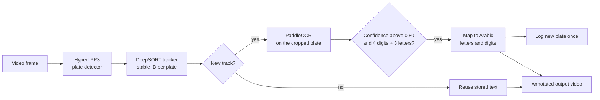

<h1 align="center">🚗 Saudi Number Plate Detection</h1>

<p align="center">An advanced real-time vehicle license plate detection and recognition system using multiple AI-powered technologies. It detects license plates in video frames, extracts text using PaddleOCR, maps English characters to Arabic equivalents, and tracks vehicles using DeepSORT.</p>

<p align="center">
  
  
  
  
  
</p>

<p align="center">
  <a href="#-pipeline"><b>Pipeline</b></a> ·
  <a href="#-plate-format-and-arabic-mapping">Arabic mapping</a> ·
  <a href="#-quick-start">Quick start</a> ·
  <a href="#-configuration">Configuration</a>
</p>

---

## 🔎 Pipeline



1. **Detect.** The HyperLPR3 multitask ONNX detector (640 x 640 input) finds plates in each frame.
2. **Track.** DeepSORT (`max_age=15`, `n_init=3`) gives every plate a stable ID, so each plate is read once instead of on every frame.
3. **Read.** PaddleOCR reads the plate crop. A result is kept only if its confidence is above 0.80 and it matches the plate format.
4. **Map.** The English letters and digits are mapped to their Arabic equivalents.
5. **Render.** Each confirmed plate gets a green box, its track ID, the Arabic text above and the English text below, drawn with the Amiri Arabic font, and the annotated video is saved. Each new plate is also printed to the console once.

## 🔤 Plate format and Arabic mapping

A plate is accepted when it is **four digits followed by three capital letters** (`^\d{4}[A-Z]{3}$`), for example `1234ABC`. Saudi plates use a set of Latin letters that mirror Arabic letters, so each character is mapped:

| Type | Example mapping |
|---|---|
| Digits | `0 1 2 3 4 5 6 7 8 9` to `٠ ١ ٢ ٣ ٤ ٥ ٦ ٧ ٨ ٩` |
| Letters | `A` to `أ`, `B` to `ب`, `D` to `د`, `R` to `ر`, `S` to `س`, `T` to `ط`, `X` to `ص`, `Z` to `ز`, and the rest of A-Z |

The console prints the result as `<English> | <Arabic with spaced letters>`.

## 🚀 Quick start

The script was written to run in Google Colab or a Linux notebook. It installs the Amiri font with `wget` and `fc-cache`.

```bash
pip install hyperlpr3 paddlepaddle paddleocr opencv-python pillow numpy deep-sort-realtime
```

1. Put your video at the path set in `video_path` (default `/content/2.mp4`).
2. Run `Number_plate_Detection.py`. In a notebook, run it as a cell so the `!wget` and `!fc-cache` font setup lines execute.
3. The annotated video is written to `output_video_path` (default `/content/Deepoutput_video.mp4`).

## 🎛️ Configuration

| Setting | Default | Meaning |
|---|---|---|
| `video_path` | `/content/2.mp4` | Input video |
| `output_video_path` | `/content/Deepoutput_video.mp4` | Annotated output video (30 fps) |
| OCR confidence | `0.80` | Minimum PaddleOCR confidence to accept a plate |
| Plate regex | `^\d{4}[A-Z]{3}$` | Accepted plate format |
| `DeepSort(max_age, n_init)` | `15`, `3` | Frames a lost track survives, and detections needed to confirm a new one |
| `english_to_arabic_mapping` | A-Z, 0-9 | Character mapping to Arabic |
